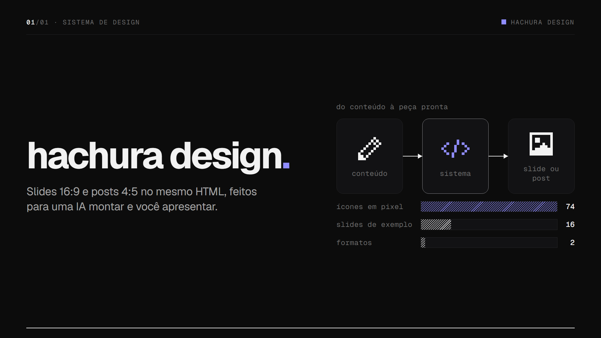
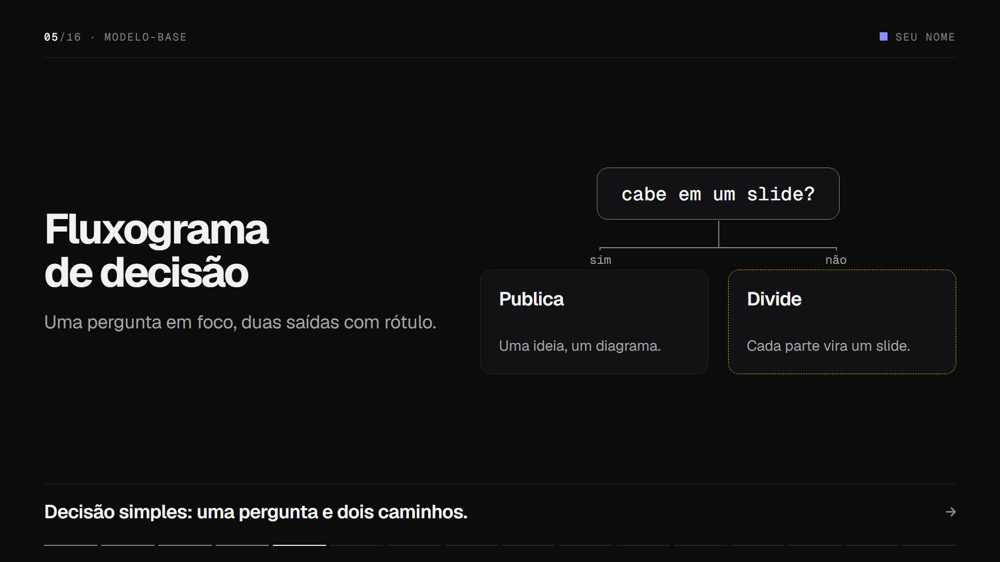
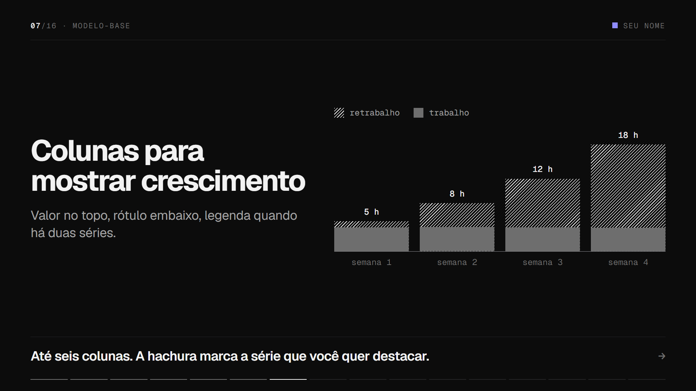
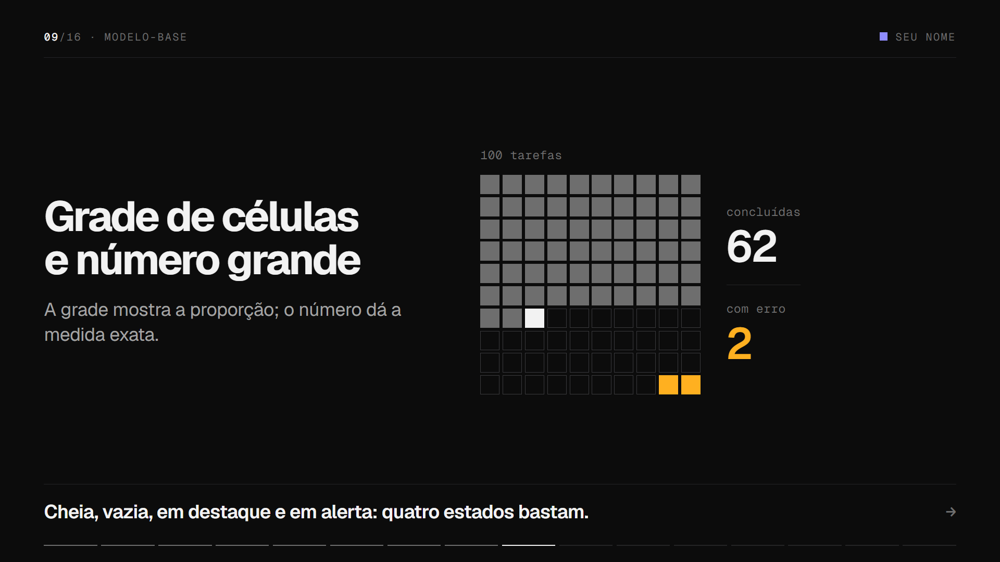
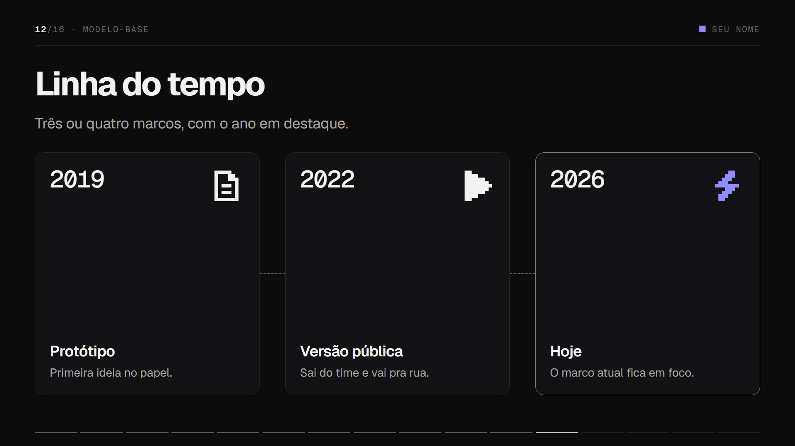
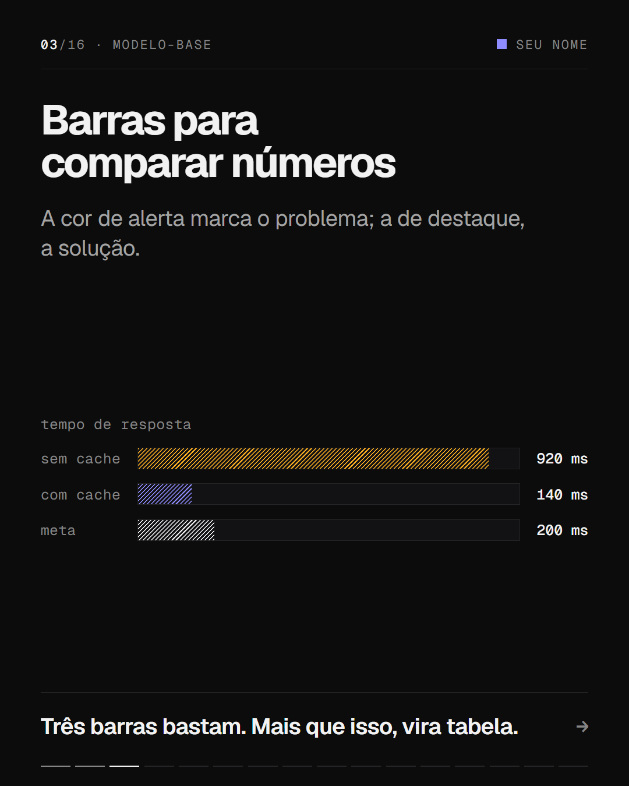
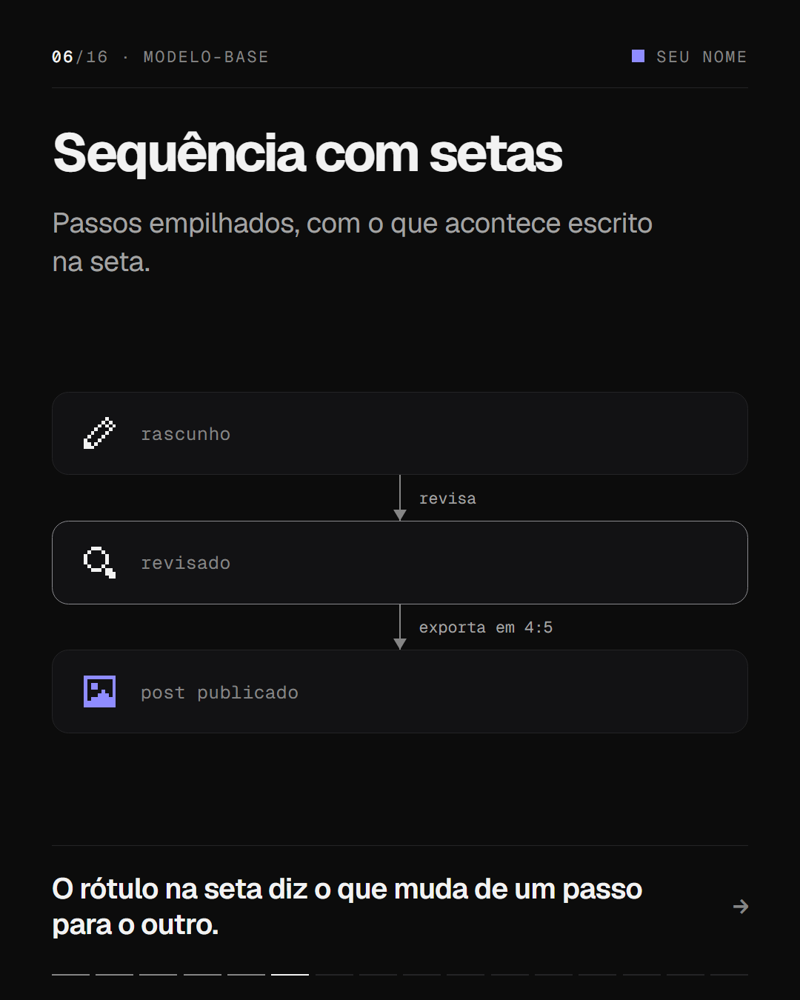
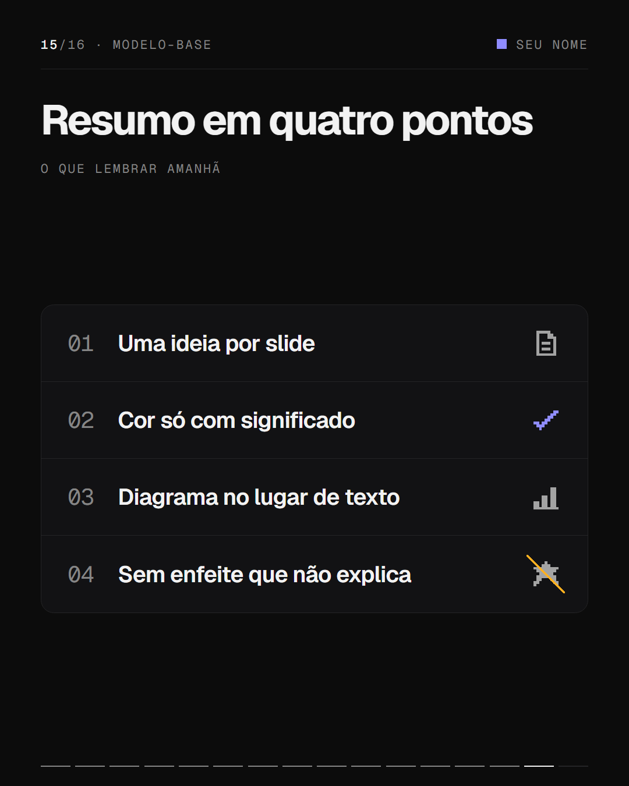

<p align="center">
  
</p>

# hachura design

Sistema de design para slides e posts. Escuro, técnico, sem enfeite: uma ideia por tela, duas
cores com significado, ícones em pixel e hachura no lugar de gradiente.

Foi feito para ser usado por IAs. Você entrega o conteúdo, a IA lê o [`AGENTS.md`](AGENTS.md),
copia o modelo e devolve um deck pronto para apresentar ou exportar.

```
01 / um HTML          serve de slide 16:9 e de post 4:5
02 / sem dependência  abre direto do disco, sem instalar, compilar nem internet
03 / uma fonte só     cada cor, componente e ícone mora em um único arquivo
```

## Componentes

| | |
|---|---|
|  |  |
|  |  |

O catálogo completo, com um exemplo de cada tipo de slide e componente, é o próprio
[`decks/modelo-base.html`](decks/modelo-base.html). Os 74 ícones estão em
[`icons/preview.html`](icons/preview.html).

## Dois formatos, o mesmo HTML

| | | |
|---|---|---|
|  |  |  |

`data-format="post"` no deck troca o slide 16:9 (1920×1080) pelo post 4:5 (1080×1350).
Para só espiar o outro formato, acrescente `?formato=post` ao endereço.

## Começar

Abra `decks/modelo-base.html` no navegador. Setas ou clique navegam, `F` entra em tela cheia.

```bash
# um deck novo é uma cópia do modelo, na mesma pasta
cp decks/modelo-base.html decks/meu-deck.html

# conferir: ícones, navegação, proporção e nada transbordando
node ferramentas/verificar.mjs decks/meu-deck.html

# exportar um PNG por slide
node ferramentas/exportar.mjs decks/meu-deck.html
node ferramentas/exportar.mjs decks/meu-deck.html --formato=post

# juntar tudo em um HTML só, para enviar a alguém
node ferramentas/empacotar.mjs decks/meu-deck.html
```

As ferramentas pedem Node 18 ou mais novo e o Edge ou o Chrome instalado. Os decks em si não
pedem nada.

## Compartilhar

| A pessoa vai | Envie |
|---|---|
| Ver com animação e navegar | O HTML único de `ferramentas/empacotar.mjs`; abre em qualquer navegador |
| Só ler | PDF: `Ctrl+P` no deck, margens "Nenhuma", gráficos de plano de fundo ligados |
| Postar | Os PNGs de `ferramentas/exportar.mjs` |

O HTML único leva as fontes embutidas e funciona sem internet.

## Estático ou animado

Ao apresentar, os slides entram com animações discretas: o texto, depois o diagrama, depois a
conclusão. Imagens e PDF mostram sempre o slide pronto.

| Quero | Como |
|---|---|
| Deck inteiro sem animação | `data-motion="off"` em `<main class="deck">` |
| Um slide sem animação | `data-motion="off"` na `<section class="slide">` |
| Desligar só agora | `?animacao=off` no endereço |
| Revelar um item por clique | `class="step"` no elemento |
| Mudar a velocidade | `--tempo` em `css/tokens.css` |

## Estrutura

```
sistema.css        ponto de entrada do estilo
sistema.js         moldura, navegação, ícones e passos
css/               fontes, tokens, base, componentes, formatos e animação
fonts/             Geist e Geist Mono (licença OFL)
icons/             74 ícones em pixel; icons.json é a fonte
decks/             os decks; modelo-base.html é o catálogo
ferramentas/       exportar e verificar
AGENTS.md          mapa completo e receitas para acrescentar peças
```

## Para IAs

Comece pelo [`AGENTS.md`](AGENTS.md). Ele diz onde fica cada coisa, quais regras valem para
toda peça e como acrescentar um deck, um componente, um ícone, uma cor, uma animação ou um
formato sem quebrar o resto.

## Contribuir

Commits seguem o [Conventional Commits](https://www.conventionalcommits.org/pt-br/v1.0.0-beta.4/),
em português. Depois de clonar, ative o hook que confere as mensagens:

```bash
git config core.hooksPath .githooks
```

A capa deste README é um deck do próprio sistema: [`decks/readme.html`](decks/readme.html).
